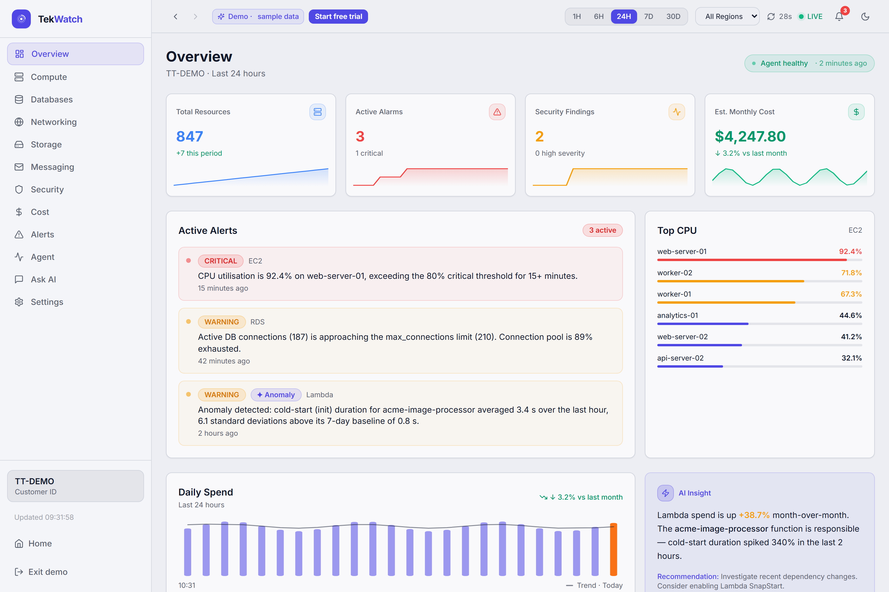
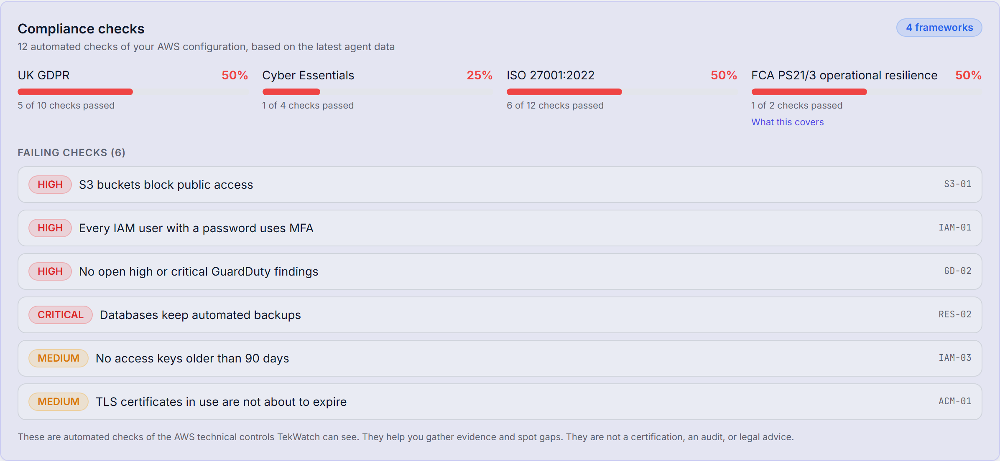
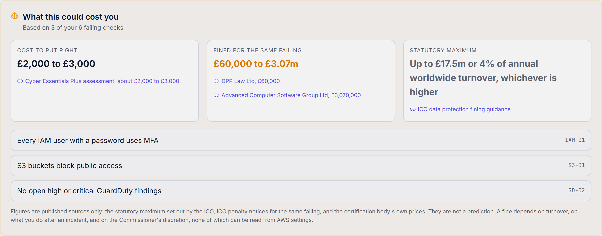
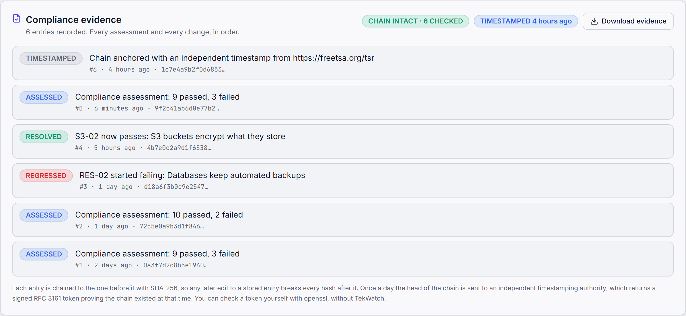
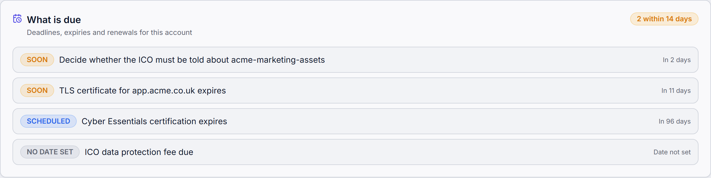
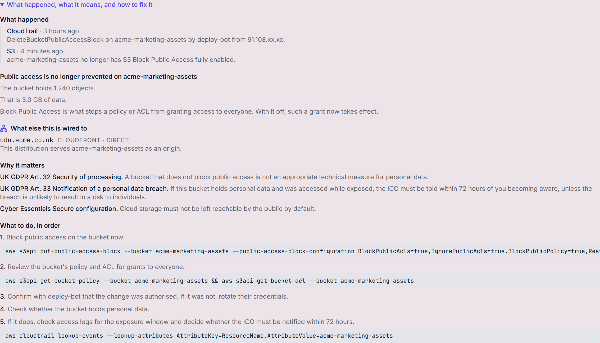
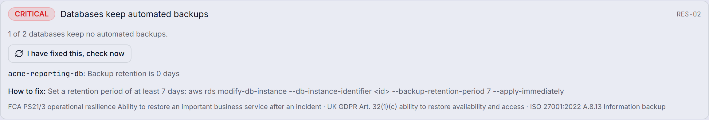
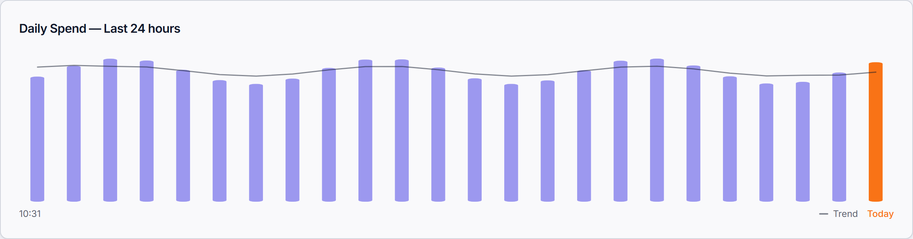

# TekWatch

> Cloud regulatory intelligence for UK small businesses running on AWS. Built by Tek Tribe Ltd.

TekWatch watches a customer's AWS account through a read-only agent, decides for
itself when something has changed or gone wrong, works out which UK regulatory
obligation that touches, says what it could cost using published figures, tells
the owner what to do in plain English, checks the fix when the evidence shows
it, and keeps a tamper-evident, independently timestamped record of the whole
sequence.

**Live:** [app.tekwatch.io](https://app.tekwatch.io) · **Demo:** [app.tekwatch.io/overview/?demo=1](https://app.tekwatch.io/overview/?demo=1) · **Region:** eu-west-2 (London)



---

## Contents

- [The workflow: seven stages](#the-workflow-seven-stages)
- [Screenshots](#screenshots)
- [What is our code, and what is Claude](#what-is-our-code-and-what-is-claude)
- [Regulatory coverage](#regulatory-coverage)
- [Financial exposure](#financial-exposure)
- [The evidence record](#the-evidence-record)
- [Dependency tracing](#dependency-tracing)
- [Regulatory calendar](#regulatory-calendar)
- [Architecture](#architecture)
- [The agent](#the-agent)
- [Repository structure](#repository-structure)
- [Local development](#local-development)
- [Testing](#testing)
- [Deployment](#deployment)
- [Customer onboarding](#customer-onboarding)
- [API endpoints](#api-endpoints)
- [Configuration](#configuration)
- [Security](#security)
- [What TekWatch does not do](#what-tekwatch-does-not-do)
- [Known gaps](#known-gaps)

---

## The workflow: seven stages

One technical event is carried all the way to a regulator-ready record. Each
stage names the module that implements it, so every claim here can be checked
against the code.

| Stage | What happens | Implemented in |
|---|---|---|
| **1. Detect** | Every metric is compared against its own seven-day baseline. A reading is an anomaly at three or five standard deviations, or when a step change holds. Needs 24 hours and 12 samples of history first. | [`api/services/alerting/detector.py`](api/services/alerting/detector.py) |
| **2. Trace** | The affected resource is looked up in the customer's own dependency graph. Edges are marked *direct* (AWS states them) or *inferred* (shared security group). One hop only. | [`api/services/topology.py`](api/services/topology.py) |
| **3. Map** | Configuration is judged against **24 technical controls across 17 AWS services**, each carrying the clause it supports in UK GDPR, Cyber Essentials v3.3, ISO 27001:2022 or FCA PS21/3. | [`api/services/compliance.py`](api/services/compliance.py) |
| **4. Quantify** | Each failing control carries published figures: the statutory maximum, ICO or FCA penalties for the same failing, and the certification body's prices. Three separate numbers, never added. | [`api/services/exposure.py`](api/services/exposure.py) |
| **5. Resolve** | A prioritised plain-English remediation plan ordered by severity, with the AWS CLI command where one exists. | `compliance.py`, `correlation.py` |
| **6. Verify** | A control moving from fail to pass is recorded the moment the agent's data shows it. "I have fixed this, check now" re-runs the check on demand. | [`api/services/evidence_recorder.py`](api/services/evidence_recorder.py) |
| **7. Record** | Every assessment and change is appended to a SHA-256 hash chain, anchored daily with an RFC 3161 token from an independent timestamping authority. | [`api/services/evidence.py`](api/services/evidence.py), [`timestamping.py`](api/services/timestamping.py) |

Across the chain sits a **regulatory calendar**
([`api/services/calendar.py`](api/services/calendar.py)): the Article 33
72-hour clock, certificate expiries, and renewals.

---

## Screenshots

All taken from the demo account, which uses sample data.

**Four frameworks, each scored only on the controls it could evaluate**



**What a failing control could cost, with every figure linked to its source**



**The evidence record: chain intact, independently timestamped, downloadable**



**The regulatory calendar, with the 72-hour ICO clock running**



**An incident traced through the dependency graph: what else it is wired to**



**Closing the loop on demand**



**Daily spend: thin bars with the moving-average trend drawn over them**



---

## What is our code, and what is Claude

Every monitoring decision (what is anomalous, what fails a check, what counts as
an incident, what it could cost) is made by TekWatch's own deterministic code.
The detection module contains no reference to any AI service, and the system
raises exactly the same alerts with every AI key removed.

| Capability | Where it runs | How it works |
|---|---|---|
| Data collection | Our agent (`agent/collectors/`) | 23 read-only boto3 collectors |
| Baselines | Our API (`api/services/timestream.py`) | 7-day mean, standard deviation and sample count per resource metric, cached for 6 hours |
| Anomaly detection | Our API (`alerting/detector.py`) | z-score against the baseline (3σ medium, 5σ high), plus step-change detection for metrics that are normally flat |
| Threshold alerts | Our API (`alerting/threshold.py`) | Default or customer thresholds, every 5 minutes |
| Compliance | Our API (`compliance.py`) | 24 rule-based controls, 17 services, 4 frameworks |
| Dependency graph | Our API (`topology.py`) | Built from relationships the agent reports |
| Incident correlation | Our API (`correlation.py`) | Joins CloudTrail changes to current state: who changed what, when, the UK GDPR impact, what else it reaches, and ordered remediation |
| Financial exposure | Our API (`exposure.py`) | Published ICO, FCA and IASME figures only |
| Evidence record | Our API (`evidence.py`, `timestamping.py`) | SHA-256 chain, daily RFC 3161 anchor |
| Alert delivery | Our API (`notifications.py`) | Email (SES) and Slack, filtered by each customer's minimum severity |
| Alert wording | Claude API, optional | Rewrites anomalies the detector already found in plain English. Discarded unless it returns exactly one explanation per anomaly. Without a key, built-in wording is used |
| AI assistant | Claude API | Answers questions using ten read-only tools over the customer's own data. It answers; it does not decide |

What is proprietary is not a model. It is the regulatory rule library, the
detection methodology, the dependency graph, the exposure mapping to published
enforcement, and the evidence chain.

---

## Regulatory coverage

| Framework | What is assessed | What is not |
|---|---|---|
| **UK GDPR** | Article 32 security of processing, Article 5(2) accountability, Article 32(1)(c) restoration | Lawful basis, consent, data subject rights: anything not readable from infrastructure |
| **Cyber Essentials v3.3** | Firewalls and internet gateways, secure configuration, user access control, and the cloud half of security update management | Malware protection, and patching on staff laptops and phones |
| **ISO 27001:2022** | Annex A access restriction, cryptography, backup, logging, monitoring, network security, redundancy, configuration management | The management system itself: policies, risk treatment, internal audit |
| **FCA PS21/3** | Technical evidence only: Multi-AZ databases, automated backups, load balancers across zones, alarms configured | Important business services, impact tolerances, scenario testing. These are governance |

Cyber Essentials and PS21/3 carry a scope note in the API payload and on the
page, so a score against part of a scheme is never read as a score against the
whole of it.

**The 24 controls**

| Area | Controls |
|---|---|
| Storage | S3-01 public access blocked · S3-02 encryption · S3-03 versioning |
| Identity | IAM-01 user MFA · IAM-02 root MFA · IAM-03 access keys under 90 days |
| Certificates | ACM-01 not expiring within 30 days |
| Threat detection | GD-01 GuardDuty on · GD-02 no open high or critical findings · SH-01 no critical Security Hub findings |
| Logging and config | CT-01 CloudTrail logging · CFG-01 AWS Config rules passing |
| Databases | RDS-01 not internet-reachable · RES-01 Multi-AZ · RES-02 automated backups · DDB-01 point-in-time recovery |
| Messaging | SQS-01 queue encryption · SNS-01 topic encryption |
| Compute and delivery | EKS-01 API endpoint not public · LAM-01 supported runtimes · CF-01 HTTPS only · EC-01 cache encryption |
| Resilience | RES-03 load balancers across zones · RES-04 alarms configured |

**Three rules keep the scoring honest, and tests enforce them:** a fact the
agent did not collect is *unknown*, never a pass; unknown and not-applicable
controls are left out of the score rather than counted; and every payload says
the result is not a certification, an audit or legal advice.

---

## Financial exposure

A made-up fine estimate in front of a regulator is worse than saying nothing,
so nothing is modelled or predicted. A published case is attached to a control
only where the regulator's own account of that case names the same failing.

| Kind | Figure | Source |
|---|---|---|
| Statutory maximum | £8.7m or 2% of turnover (Article 32); £17.5m or 4% (Article 5) | [ICO fining guidance](https://ico.org.uk/about-the-ico/our-information/policies-and-procedures/data-protection-fining-guidance/statutory-background/the-maximum-amount-of-a-fine-under-uk-gdpr-and-dpa-2018/) |
| Enforcement | Advanced Computer Software Group, £3.07m, March 2025, missing MFA | [ICO](https://ico.org.uk/action-weve-taken/enforcement/2025/03/advanced-computer-software-group-limited/) |
| Enforcement | DPP Law Ltd, £60,000, April 2025, missing MFA and late reporting | [ICO](https://ico.org.uk/action-weve-taken/enforcement/2025/04/dpp-law-ltd/) |
| Enforcement | Tuckers Solicitors LLP, £98,000, March 2022, unencrypted backups | [ICO](https://ico.org.uk/for-organisations/uk-gdpr-guidance-and-resources/security/encryption/encryption-scenarios/) |
| Enforcement (FCA-regulated only) | TSB Bank plc, £48.65m, December 2022, operational resilience | [FCA](https://www.fca.org.uk/news/press-releases/tsb-fined-48m-operational-resilience-failings) |
| Enforcement (FCA-regulated only) | Equifax Ltd, £11,164,400, October 2023, known weaknesses not acted on | [FCA](https://www.fca.org.uk/news/press-releases/equifax-ltd-fine-cyber-security-breach) |
| Direct cost | Cyber Essentials Plus assessment, about £2,000 to £3,000 | [IASME](https://iasme.co.uk/articles/cyber-essentials-and-cyber-essentials-plus-what-is-the-difference/) |

FCA and PRA penalties are marked as reaching regulated firms only, on the page
and in the data.

---

## The evidence record

A compliance page says what is wrong today. The evidence record says what was
wrong, when it was fixed, and proves nobody has edited the answer since.

- **Chained.** Each entry carries the SHA-256 hash of the one before it. Edit a
  stored entry and every hash after it stops matching.
- **Verified from the data.** `GET /api/v1/security/evidence/verify` recomputes
  the whole chain from the stored entries, not from a stored answer.
- **Independently timestamped.** Once a day the head of the chain goes to an
  RFC 3161 timestamping authority, which returns a signed token saying it saw
  that hash at that time. Best effort and off the hot path: if the authority is
  down, the log carries on and tries again tomorrow.
- **Checkable without us.** The CSV export carries the verification command.
  With the token saved as `token.tsr` and the authority's certificates:

```bash
openssl ts -verify -digest <anchored_hash> -in token.tsr -CAfile cacert.pem -untrusted tsa.crt
```

The RFC 3161 request is built by hand
([`timestamping.py`](api/services/timestamping.py)) rather than through an
ASN.1 library: about sixty bytes and a status check. It has been confirmed
against FreeTSA, with `openssl ts -reply -text` showing the granted status, the
SHA-256 algorithm and our exact hash.

What an anchor does not prove, and the product says so: that the chain existed
at that time, not that the records are correct. A log with no anchor yet says
so instead of borrowing the claim.

---

## Dependency tracing

The graph is built only from relationships the agent really reports, and every
edge says how sure it is.

| Edge | Confidence | Source |
|---|---|---|
| CloudFront distribution serves an S3 bucket | direct | The distribution's own origin list |
| Resource runs inside a VPC | direct | The resource's own VPC placement |
| Resources share a security group | inferred | Shared group membership; they can usually reach each other |

We do not collect VPC flow logs or security group rules, so the strongest claim
anywhere in the output is "can usually reach", never "talks to". Impact stops
at one hop: two hops through a shared VPC reaches the whole account and tells
the reader nothing.

---

## Regulatory calendar

Every entry has something real behind it.

| Kind | Example | Driven by |
|---|---|---|
| Deadline | Decide whether the ICO must be told about a bucket | The 72 hours of Article 33, counted from when TekWatch first saw the exposure |
| Expiry | TLS certificate for app.example.com expires | The expiry date AWS reports |
| Renewal | Cyber Essentials certificate, ICO data protection fee | Dates only the customer knows. Until entered, the entry says "no date set" rather than inventing one |

---

## Architecture

```
Customer AWS account                              TekWatch central account (eu-west-2)
┌──────────────────────────────┐                 ┌─────────────────────────────────────────┐
│ EventBridge (every 15 min)   │                 │ SQS ingest queue                        │
│   └─ ECS Fargate: agent  ────┼── HTTPS, out ──▶│   └─ ECS: ingest-consumer               │
│      23 read-only collectors │     only        │        └─ DynamoDB metrics + events     │
│      key from Secrets Mgr    │                 │           (90-day TTL)                  │
└──────────────────────────────┘                 │ ECS: api (FastAPI)                      │
                                                 │   ├─ detection, compliance, topology,   │
                                                 │   │  exposure, evidence, calendar       │
                                                 │   └─ background loops: thresholds,      │
                                                 │      anomalies, evidence recording      │
                                                 │ S3 + CloudFront                         │
                                                 │   ├─ app.tekwatch.io   (dashboard)      │
                                                 │   └─ admin.tekwatch.io (admin portal)   │
                                                 │ Cognito · SES · Lambda silence detector │
                                                 └─────────────────────────────────────────┘
                                                              │ once a day
                                                              ▼
                                                  RFC 3161 timestamping authority
```

Browsers reach the API through a CloudFront `/api/*` behaviour on
`app.tekwatch.io`.

---

## The agent

A Python container that runs in the customer's own AWS account, collects, sends,
and exits.

| | |
|---|---|
| Collectors | 23: EC2, RDS, Lambda, ECS, EKS, S3, DynamoDB, ELB, VPC, Route53, CloudFront, ElastiCache, SNS, SQS, ACM, IAM, GuardDuty, Security Hub, Config, CloudTrail, CloudWatch Alarms, Cost Explorer, Trusted Advisor |
| Permissions | AWS `ReadOnlyAccess` plus sending to one SQS queue. No inbound access |
| Schedule | Home region every run (default 15 minutes). All enabled regions every 30 minutes. Cost Explorer every 6 hours, because it bills per request |
| Deadline | A run stops one minute short of its interval and publishes what it has, so runs can never pile up |
| Rule | A fact it could not read is left out, never reported as a convenient false |

Scheduling is stateless: each run works out what is due from the clock, rounded
to the nearest schedule slot to absorb EventBridge jitter. See
[`agent/utils/schedule.py`](agent/utils/schedule.py).

---

## Repository structure

```
Tek-Watch/
├── agent/                  # Collection agent (runs in the customer's account)
│   ├── collectors/         # 23 read-only collectors
│   └── utils/schedule.py   # What is due on this run
├── ingest-consumer/        # SQS consumer, validates keys, writes to DynamoDB
├── api/                    # FastAPI central API
│   ├── services/           # detector, compliance, topology, exposure,
│   │                       # evidence, timestamping, calendar, correlation
│   └── routers/            # HTTP endpoints
├── dashboard/              # Next.js customer dashboard (app.tekwatch.io)
├── admin-portal/           # Next.js admin portal (admin.tekwatch.io)
├── infrastructure/
│   ├── terraform/          # Central account
│   └── lambda/             # Silence detector
├── docs/                   # Architecture, guide, runbook, screenshots
├── .github/workflows/      # CI/CD
└── docker-compose.yml      # Local development
```

---

## Local development

**Prerequisites:** Docker and Docker Compose, Python 3.12+, Node.js 18+, AWS CLI.

```bash
git clone https://github.com/Mide69/Tek-Watch.git
cd Tek-Watch
cp .env.example .env.local        # then edit
docker-compose up
```

| Service | URL |
|---|---|
| API | http://localhost:8000 |
| API docs | http://localhost:8000/docs |
| LocalStack | http://localhost:4566 |

Run a service on its own:

```bash
cd api && pip install -r requirements.txt && uvicorn main:app --reload
cd dashboard && npm install && npm run dev      # demo mode: /overview/?demo=1
cd agent && pip install -r requirements.txt && python main.py
```

---

## Testing

**877 automated tests**, all passing.

| Suite | Tests | Command |
|---|---|---|
| API | 470 | `cd api && pytest` |
| Agent | 291 | `cd agent && pytest` |
| Ingest consumer | 28 | `cd ingest-consumer && pytest` |
| Dashboard | 88 | `cd dashboard && npm test` |

Plus Playwright end-to-end suites for the dashboard and admin portal
(`npm run test:e2e`).

The tests pin the honesty rules as well as the behaviour: an uncollected fact is
never a pass, a control with no published source produces no exposure figure,
editing any evidence entry breaks the chain, a refused timestamp is never stored
as proof, and no test reaches a real timestamping authority.

---

## Deployment

CI/CD runs from GitHub Actions and is enabled by the `ENABLE_CD` repository
variable.

| Event | What happens |
|---|---|
| Pull request | Tests only |
| Push to `main` | Tests, then images are built and pushed to ECR |
| `workflow_dispatch` | Production deploy of that service |

> **Important:** a push to `main` that touches `agent/` publishes the agent to
> ECR Public as `:latest`, and customer stacks pull `:latest` on every run. For
> the agent, **merging to `main` is a deploy**. The API, dashboard and ingest
> consumer only go live on a manual dispatch.

```bash
gh workflow run api.yml --ref main
gh workflow run dashboard.yml --ref main
gh workflow run ingest-consumer.yml --ref main
```

Terraform deliberately does not manage the running task definition revision
(`ignore_changes`), because CD owns it. See
[`infrastructure/terraform/README.md`](infrastructure/terraform/README.md).

---

## Customer onboarding

There is one template, generated per customer by the API
([`api/services/cfn_template.py`](api/services/cfn_template.py)).

1. **Download the template** from the Agent page. It carries the Customer ID,
   the ingest queue and the agent image. It never contains the agent key.
2. **Create the agent key** on the same page with "Create agent key". It is
   shown once. The API stores only a hash.
3. **Create the stack** in your own AWS account, pasting the key into the hidden
   `APIKey` field, or:

```bash
aws cloudformation create-stack \
  --stack-name tek-watch-agent \
  --template-body file://tek-watch-agent-TT-XXXXXXXX.yaml \
  --parameters \
    ParameterKey=APIKey,ParameterValue=<your key> \
    ParameterKey=VpcId,ParameterValue=vpc-0123456789abcdef0 \
    ParameterKey=SubnetIds,ParameterValue=subnet-0123456789abcdef0 \
    ParameterKey=RunIntervalMinutes,ParameterValue=15 \
  --capabilities CAPABILITY_NAMED_IAM
```

It creates an ECS cluster and task, a read-only task role, the key in Secrets
Manager, an outbound-only security group and an EventBridge schedule. Data
appears within about 20 minutes.

The key used to be embedded in the template as a parameter default, which
CloudFormation stores in the template body where anyone with `GetTemplate` can
read it. It no longer is.

---

## API endpoints

All customer endpoints require a Cognito JWT.

**Monitoring**
- `GET /api/v1/overview` · `GET /api/v1/compute/{ec2,lambda,ecs}` · `GET /api/v1/databases/{rds,dynamodb}`
- `GET /api/v1/storage/s3` · `GET /api/v1/networking/{vpc,elb}` · `GET /api/v1/metrics/{resource_id}`
- `GET /api/v1/alerts` · `GET /api/v1/cost/summary` · `GET /api/v1/cost/breakdown`

**Regulatory intelligence**
- `GET /api/v1/security/compliance` — the 24 controls, four frameworks, and published exposure
- `GET /api/v1/security/incidents` — correlated incidents, with what else each one reaches
- `GET /api/v1/security/topology` — the dependency graph
- `GET /api/v1/security/calendar` — deadlines, expiries, renewals
- `PUT /api/v1/security/calendar/renewals` — set Cyber Essentials and ICO fee dates
- `POST /api/v1/security/controls/{id}/recheck` — re-run the checks now and record the result
- `GET /api/v1/security/evidence` — the evidence log
- `GET /api/v1/security/evidence/verify` — recompute the chain
- `GET /api/v1/security/evidence/export` — CSV with hashes and verification instructions
- `GET /api/v1/security/{guardduty,iam,acm,alarms}`

**Agent**
- `GET /api/v1/agent/health` · `GET /api/v1/agent/cfn-template`
- `POST /api/v1/agent/key` — issue the agent key, shown once; `{"replace": true}` to replace

**Account**
- `GET|PUT /api/v1/profile` · `POST|DELETE /api/v1/profile/logo`
- `GET|PUT /api/v1/notifications/preferences`

**Admin** (admin JWT)
- `GET|POST /api/v1/admin/customers` · `PUT /api/v1/admin/customers/{id}`
- `POST /api/v1/admin/customers/{id}/rotate-key` · `GET /api/v1/admin/thresholds` · `GET /api/v1/admin/operations`

---

## Configuration

See `.env.example` for everything. Production reads secrets from AWS Secrets
Manager via `SECRETS_MANAGER_SECRET_ARN`.

| Variable | Used by | Purpose |
|---|---|---|
| `TEK_WATCH_CUSTOMER_ID` | agent | Customer the data belongs to |
| `TEK_WATCH_INGEST_QUEUE_URL` | agent | Where to send |
| `TEK_WATCH_API_KEY` | agent | From Secrets Manager, never in the task definition |
| `TEK_WATCH_RUN_INTERVAL_MINUTES` | agent | Must match the schedule. 5, 10 or 15; default 5 for older stacks |
| `AWS_REGION`, `ENVIRONMENT` | API, consumer | Region and environment |
| `TSA_URL` | API | RFC 3161 authority. Default `https://freetsa.org/tsr`; empty turns anchoring off |
| `AGENT_PUBLIC_IMAGE_URI` | API | Image written into customer templates |

---

## Security

- The agent is read-only and outbound-only. No inbound firewall change is needed.
- Agent keys are stored as SHA-256 hashes, shown once, and never written into a
  template. The ingest consumer re-reads a customer's key within 60 seconds, so
  a rotated key takes effect without a restart.
- Customer data is isolated by `customer_id` in every query.
- Cognito JWTs; the admin portal requires MFA.
- CloudFront sends HSTS, `X-Content-Type-Options: nosniff`,
  `X-Frame-Options: DENY`, a strict referrer policy and a permissions policy.

---

## What TekWatch does not do

Stated here so nobody has to find out.

- No traffic analysis. Without flow logs, the graph says resources *can* reach
  each other, never that they do.
- No device or endpoint checks, so two of the five Cyber Essentials controls are
  out of scope.
- No impact-tolerance testing or scenario exercises for PS21/3, only the
  technical evidence that supports them.
- No certification, audit or legal advice. Every compliance payload says so.

---

## Known gaps

- [ ] No independent penetration test of the platform yet.
- [ ] No staging environment. `staging.tfvars` is ready but unused, and
      `deploy-dev` and `deploy-staging` are gated off.
- [ ] The ALB serves HTTP; browsers reach the API over HTTPS through CloudFront.
      A dedicated `api.tekwatch.io` certificate would let clients address it
      directly.
- [ ] The GitHub Actions IAM role holds `AdministratorAccess`, limited to this
      repository by the OIDC trust condition. It should be scoped down.
- [ ] Several pinned Actions still target Node 20, which GitHub has deprecated.
- [ ] Roadmap: one screen that walks a finding through all seven stages, an
      availability-zone loss report, a formal audit pack, and the statistics
      behind each detection shown on the alert.

---

## Docs

- [Architecture](docs/ARCHITECTURE.md)
- [Deployment and testing guide](docs/GUIDE.md)
- [Runbook](docs/RUNBOOK.md)

## Licence

Proprietary. Copyright © 2026 Tek Tribe Ltd. All rights reserved. See
[LICENSE](LICENSE).

## Support

Customers: support@tekwatch.io
